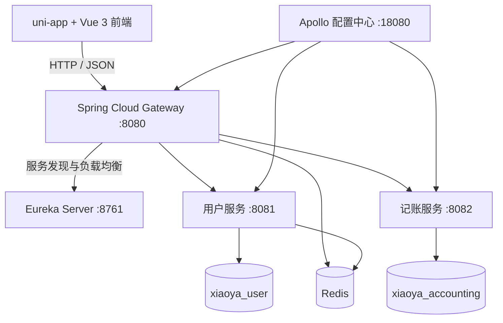

## 1. 文档说明

本文档用于说明“小芽记账”第一版的整体架构、模块职责、技术栈落地方式、核心业务流程、数据设计和运行方式，使读者在不逐行阅读代码的情况下，也能理解系统如何组成、各服务如何协作以及第一版已经跑通的技术能力。

相关文档：

- [小芽记账 App 第一版规格](./小芽记账App项目规划.md)
- [第一版接口文档](./第一版接口文档.md)
- [第一版数据库设计](./第一版数据库设计.md)

## 2. 项目背景与目标

小芽记账是一款面向个人用户的轻量级记账应用。第一版以“跑通完整业务链路和微服务技术栈”为主要目标，实现用户注册登录、账单管理、月度统计和分类预算等基础能力。

第一版重点验证以下内容：

1. uni-app 前端能够通过统一网关调用后端服务。
2. 后端能够以 Spring Cloud 微服务形式拆分、注册、发现和路由。
3. Gateway 能够统一完成 JWT 身份认证和用户身份传递。
4. Redis 能够支持退出登录后的 Token 撤销。
5. Apollo 能够集中管理不同服务的运行配置。
6. MySQL、MyBatis 和 Flyway 能够完成数据持久化及数据库版本管理。
7. 账单、统计和预算功能能够形成完整的数据联动。

## 3. 第一版功能范围

### 3.1 用户功能

- 用户注册
- 用户登录
- 查询当前用户信息
- 退出登录
- 登录状态失效后自动返回登录页

### 3.2 账单功能

- 新增收入或支出账单
- 按月份、类型和分类分页查询账单
- 查询账单详情
- 编辑账单
- 删除账单
- 使用系统内置的收入、支出分类

### 3.3 统计与预算功能

- 查询指定月份的收入、支出和结余
- 按分类汇总月度支出
- 设置或修改分类月预算
- 清除分类月预算
- 计算预算总额、已使用金额、剩余金额和使用进度
- 账单发生变化后重新加载统计及预算数据

### 3.4 前端页面

- 登录页
- 注册页
- 首页／账单列表页
- 新增与编辑账单页
- 统计页
- 预算页
- “我的”页面
- 公共底部导航栏

## 4. 总体架构

项目采用前后端分离的 Spring Cloud 微服务架构。前端不直接访问具体业务服务，而是统一访问 Gateway；Gateway 验证身份后，再通过 Eureka 中注册的服务名称将请求转发到对应服务。



### 4.1 一次受保护请求的链路

以“查询账单”为例：

1. 前端从本地缓存读取 Token，并放入 `Authorization: Bearer {token}` 请求头。
2. 请求发送到 Gateway 的 `/api/bills` 地址。
3. Gateway 验证 JWT 签名和有效期。
4. Gateway 根据 Token 的 SHA-256 摘要查询 Redis，确认 Token 未被撤销。
5. Gateway 从 JWT 的 subject 中取得用户 ID，并覆盖写入 `X-User-Id` 请求头。
6. Gateway 通过 Eureka 查找 `xiaoya-accounting-service` 实例并转发请求。
7. 记账服务使用可信的 `X-User-Id` 查询当前用户自己的账单。
8. 服务返回统一 JSON 响应，前端更新页面。

## 5. 项目结构

```text
xiaoya-accounting/
├─ app-uniapp-vue3/
│  └─ app-uniapp-vue3/           # uni-app + Vue 3 前端工程
├─ xiaoya-backend/               # Maven 后端父工程
│  ├─ xiaoya-eureka-server/      # 服务注册中心
│  ├─ xiaoya-gateway/            # API 网关与统一鉴权
│  ├─ xiaoya-user-service/       # 用户、登录和退出登录
│  └─ xiaoya-accounting-service/ # 账单、分类、预算和统计
├─ docs/                         # 项目设计与接口文档
└─ README.md                     # 仓库首页及快速运行说明
```

后端使用 Maven 聚合父工程统一管理模块、Java 版本、Spring Cloud 依赖版本和 Apollo Client 版本。各子服务按职责引入自己的依赖，避免所有服务无差别加载同一套组件。

## 6. 模块设计

### 6.1 前端应用

前端基于 uni-app 和 Vue 3 开发，当前主要运行目标为 H5，也保留继续适配移动端的能力。

主要职责：

- 提供登录、注册、账单、统计、预算和个人中心界面。
- 通过统一的 `utils/request.js` 封装请求。
- 自动为受保护接口添加 JWT Token。
- 遇到 HTTP 401 时清除本地 Token，并引导用户重新登录。
- 通过底部导航栏切换主要业务页面。
- 使用响应式布局适配不同手机屏幕宽度。

本地开发时，前端默认通过 `http://localhost:8080` 访问 Gateway。使用手机在同一局域网访问时，需要将地址临时替换为开发电脑的局域网 IP，并在 Gateway 的跨域配置中允许对应前端来源。

### 6.2 Eureka Server

模块名：`xiaoya-eureka-server`  
默认端口：`8761`

主要职责：

- 作为服务注册中心保存各微服务实例信息。
- 用户服务、记账服务和 Gateway 启动后向 Eureka 注册。
- Gateway 根据服务名称发现真实服务地址，不需要写死业务服务的 IP 和端口。

Eureka Server 本身不向自己注册，也不从其他 Eureka 节点拉取注册表，符合当前单机开发环境的配置。

### 6.3 Gateway

模块名：`xiaoya-gateway`  
默认端口：`8080`

主要职责：

- 对前端提供统一 API 入口。
- 根据请求路径将请求路由到用户服务或记账服务。
- 对注册和登录接口匿名放行。
- 对其他接口统一验证 JWT。
- 查询 Redis 中的 Token 撤销标记。
- 将可信用户 ID 写入 `X-User-Id` 请求头。
- 覆盖客户端自行传入的同名请求头，防止伪造用户身份。
- 返回统一的 HTTP 401 未授权响应。
- 处理 H5 前端访问后端时的跨域配置。

主要路由关系：

| 外部路径 | 目标服务 | 说明 |
| --- | --- | --- |
| `/api/users/**` | `xiaoya-user-service` | 注册、登录、当前用户和退出登录 |
| `/api/categories` | `xiaoya-accounting-service` | 系统分类 |
| `/api/bills/**` | `xiaoya-accounting-service` | 账单管理 |
| `/api/budgets/**` | `xiaoya-accounting-service` | 预算管理 |
| `/api/statistics/**` | `xiaoya-accounting-service` | 月度统计 |
| `/api/accounting/**` | `xiaoya-accounting-service` | 记账服务健康检查等接口 |

### 6.4 用户服务

模块名：`xiaoya-user-service`  
默认端口：`8081`  
数据库：`xiaoya_user`

主要职责：

- 校验注册参数并创建用户。
- 使用 BCrypt 保存密码哈希，不保存明文密码。
- 校验登录用户名和密码。
- 登录成功后签发 JWT。
- 查询当前用户的公开信息。
- 退出登录时将 Token 撤销标记写入 Redis。

用户服务不会信任前端直接提交的用户 ID。受保护请求中的用户 ID 必须由 Gateway 完成 JWT 验证后通过 `X-User-Id` 传递。

### 6.5 记账服务

模块名：`xiaoya-accounting-service`  
默认端口：`8082`  
数据库：`xiaoya_accounting`

主要职责：

- 管理系统收入和支出分类。
- 完成账单新增、查询、修改和删除。
- 对账单进行分页和条件筛选。
- 按月计算收入、支出、结余和分类汇总。
- 管理月度分类预算。
- 根据账单数据计算预算使用情况。

记账服务只操作当前 `X-User-Id` 对应的数据，从业务层保证不同用户之间的数据隔离。

## 7. 技术栈及实际用途

| 技术 | 当前版本／形式 | 在项目中的用途 |
| --- | --- | --- |
| Java | 21 | 后端开发语言 |
| Spring Boot | 3.5.16 | 构建各个独立后端服务 |
| Spring Cloud | 2025.0.3 | 微服务依赖体系 |
| Spring Cloud Netflix Eureka | Server / Client | 服务注册与发现 |
| Spring Cloud Gateway | 响应式网关 | 统一路由、鉴权和跨域处理 |
| Apollo Client | 2.5.0 | 从 Apollo 配置中心读取服务配置 |
| MySQL | 两个业务数据库 | 持久化用户和记账数据 |
| MyBatis | 3.0.5 Starter | Java 对象与 SQL 数据访问映射 |
| Flyway | Spring Boot 集成 | 启动时执行数据库版本脚本 |
| Redis | Spring Data Redis | 保存已撤销 Token 的临时标记 |
| JWT / JJWT | 0.12.6 | 生成和验证登录凭证 |
| BCrypt | Spring Security Crypto | 对用户密码进行不可逆哈希 |
| PageHelper | 2.1.0 Starter | 账单列表分页查询 |
| uni-app | Vue 3 工程 | 构建 H5 与移动端页面 |
| Vue 3 | 组合式 API | 前端页面和状态组织 |
| Maven | 多模块父工程 | 构建后端及统一依赖版本 |
| Git / GitHub | 代码仓库 | 版本管理与项目展示 |

## 8. 核心业务流程

### 8.1 用户注册

1. 前端提交用户名、密码等注册信息。
2. Gateway 识别 `/api/users/register` 为匿名接口，直接转发。
3. 用户服务使用参数校验规则检查输入。
4. 用户服务检查用户名是否已存在。
5. 密码通过 BCrypt 生成哈希后写入 `users` 表。
6. 返回新用户的公开信息，不返回密码和密码哈希。

### 8.2 用户登录

1. 前端向 `/api/users/login` 提交用户名和密码。
2. 用户服务查询用户并使用 BCrypt 验证密码。
3. 验证成功后，以用户 ID 作为 JWT subject，并写入用户名及过期时间。
4. JWT 使用配置中的密钥签名后返回前端。
5. 前端将 Token 保存到本地存储，后续请求自动携带。

### 8.3 Gateway 鉴权

1. Gateway 从 `Authorization` 请求头提取 Bearer Token。
2. 使用与用户服务一致的密钥验证 JWT 签名。
3. JWT 解析过程同时检查有效期。
4. 从 subject 读取用户 ID。
5. 计算 Token 的 SHA-256 摘要并查询 Redis。
6. Token 合法且未撤销时，将用户 ID 写入 `X-User-Id` 并继续转发。
7. Token 缺失、签名错误、已过期或已撤销时返回 HTTP 401。

### 8.4 退出登录与 Redis 撤销机制

JWT 本身是无状态凭证，签发后在过期前通常仍可使用。为了让“退出登录”立即生效，系统增加了 Redis 撤销记录：

1. 前端携带当前 Token 调用 `POST /api/users/logout`。
2. 用户服务计算 Token 的 SHA-256 摘要。
3. 用户服务以 `xiaoya:auth:revoked:{摘要}` 为 key 写入 Redis。
4. Redis key 的过期时间等于 Token 剩余有效时间，Token 自然过期后记录自动清理。
5. 前端收到成功响应后删除本地 Token。
6. 此 Token 再次访问普通受保护接口时，Gateway 查询到撤销标记并返回 401。

Redis 中只保存摘要，不保存原始 Token。Gateway 和用户服务必须使用完全一致的 key 前缀与 SHA-256 算法。

退出接口允许已撤销 Token 再次到达用户服务，因此重复点击退出仍可成功，满足接口幂等性。

### 8.5 账单新增、修改和删除

1. 前端提交账单类型、分类、金额、日期、备注等数据。
2. Gateway 验证身份并传递用户 ID。
3. 记账服务校验金额、类型、分类及日期。
4. 记账服务以当前用户 ID 写入或更新账单。
5. 修改和删除时同时校验账单是否属于当前用户。
6. 操作完成后，前端重新加载账单、统计和预算，使相关页面保持一致。

### 8.6 月度统计

1. 前端传入目标月份。
2. 记账服务按用户 ID 和日期范围筛选账单。
3. 分别汇总收入与支出，计算结余。
4. 对支出按分类聚合，为前端统计页面提供分类金额及占比数据。

### 8.7 分类预算

1. 用户为指定月份和支出分类设置预算金额。
2. 服务创建或取得对应的 `monthly_budgets` 主记录。
3. 在 `category_budgets` 中新增或更新分类预算。
4. 服务重新汇总分类预算并维护月预算总额。
5. 查询预算时，将分类预算与当月实际支出组合计算。
6. 返回预算金额、已用金额、剩余金额和使用比例。

### 8.8 Apollo 配置读取

Gateway、用户服务和记账服务均接入 Apollo Client，并使用各自的 `app.id` 读取 `application` namespace：

- `xiaoya-gateway`
- `xiaoya-user-service`
- `xiaoya-accounting-service`

服务启动时先通过 `apollo.meta` 连接 Apollo Config Service，再按照当前 AppId、环境和集群读取已发布配置。Apollo 中适合保存会随环境变化或需要集中维护的配置，例如：

- Eureka 服务地址
- MySQL 连接地址、用户名等连接参数
- Redis 地址、端口等连接参数
- JWT 有效期
- Gateway 跨域允许来源
- 日志级别和其他可调业务参数

数据库密码和 JWT 签名密钥属于敏感信息。当前工程使用 `DB_PASSWORD` 和 `XIAOYA_JWT_SECRET` 环境变量提供，避免把真实凭证提交到 GitHub。生产环境应进一步结合密钥管理方案，不建议将明文密钥直接公开。

Apollo 配置必须“发布”后客户端才能读取；仅在 Portal 页面编辑但没有发布，不会成为服务正在使用的正式配置。

## 9. 数据库设计

项目按微服务边界拆分为两个业务数据库，用户服务不直接操作记账数据库，记账服务也不直接操作用户数据库。

### 9.1 用户数据库 `xiaoya_user`

| 表名 | 用途 |
| --- | --- |
| `users` | 保存用户名、BCrypt 密码哈希和创建更新时间 |

### 9.2 记账数据库 `xiaoya_accounting`

| 表名 | 用途 |
| --- | --- |
| `categories` | 保存系统内置收入、支出分类 |
| `bills` | 保存用户收入与支出账单 |
| `monthly_budgets` | 保存用户每月预算主记录和总额 |
| `category_budgets` | 保存月预算下各支出分类的预算明细 |

`bills.user_id` 不设置到用户数据库的物理外键，因为两个表属于不同微服务和不同数据库。用户归属关系通过业务字段和服务逻辑维护。

详细字段、索引和约束见[第一版数据库设计](./第一版数据库设计.md)。

### 9.3 Flyway 迁移

用户服务和记账服务均启用 Flyway：

- 用户服务通过 `V1__create_users_table.sql` 创建用户表。
- 记账服务通过 `V1__create_accounting_tables.sql` 创建记账相关表并初始化系统分类。

Flyway 会记录已执行的版本，保证相同迁移脚本不会在每次启动时重复执行。后续修改数据库结构时，应新增更高版本脚本，不应直接修改已经在环境中执行过的历史脚本。

## 10. API 设计约定

### 10.1 统一入口

前端统一通过 Gateway 的 `http://localhost:8080/api/**` 访问后端，不直接调用 8081 或 8082 端口。

### 10.2 统一响应

接口使用统一响应结构表达业务结果，核心字段包括：

- `code`：业务状态码
- `msg`：提示信息
- `errorCode`：错误类型
- `data`：业务数据

HTTP 状态码同时表达请求层面的结果，例如参数错误、未认证或资源不存在。

### 10.3 用户数据隔离

- 用户 ID 来源于经过验证的 JWT，不接受前端自行指定。
- Gateway 覆盖 `X-User-Id`，阻止伪造身份。
- 账单、统计和预算查询均带当前用户 ID 条件。
- 修改和删除操作会检查目标数据是否属于当前用户。

完整路径、参数和响应示例见[第一版接口文档](./第一版接口文档.md)。

## 11. 配置与环境变量

### 11.1 本地保留的基础配置

各服务的 `application.yml` 保留启动所需的基础信息，例如：

- 服务端口
- `spring.application.name`
- Apollo AppId、Meta Server 和 namespace
- MyBatis Mapper 位置
- Flyway 脚本位置
- Gateway 路由骨架

这些配置可以让服务知道“自己是谁、如何连接配置中心以及代码资源在哪里”。

### 11.2 Apollo 集中配置

随环境变化、需要统一维护或可能在线调整的配置放入 Apollo。不同服务使用自己的 AppId，避免互不相关的配置混在一起。

### 11.3 敏感环境变量

本地启动前至少需要准备：

```text
DB_PASSWORD=本地 MySQL 密码
XIAOYA_JWT_SECRET=不少于 32 字节的 JWT 密钥
```

用户服务和 Gateway 必须使用相同的 JWT 密钥，否则用户服务签发的 Token 无法通过 Gateway 验证。

## 12. 启动与运行设计

### 12.1 基础环境

- JDK 21
- Maven
- MySQL
- Redis
- Apollo Config Service、Admin Service 和 Portal
- HBuilderX 或前端所需运行环境

### 12.2 推荐启动顺序

1. 启动 MySQL，保证业务数据库可连接。
2. 启动 Redis，保证登录退出机制可用。
3. 启动 Apollo 相关服务，保证集中配置可读取。
4. 启动 Eureka Server，打开 `http://localhost:8761` 检查注册中心。
5. 启动用户服务，确认注册到 Eureka。
6. 启动记账服务，确认注册到 Eureka。
7. 启动 Gateway，确认注册到 Eureka 且端口 8080 可用。
8. 启动 uni-app H5 前端。
9. 从注册、登录开始验证完整业务流程。

该顺序的原因是业务服务依赖数据库、Redis、Apollo 和 Eureka；Gateway 又依赖 Eureka 中存在可路由的业务服务。按依赖顺序启动可以减少连接失败和服务暂时不可用的问题。

### 12.3 最小验证清单

1. Eureka 页面能看到 Gateway、用户服务和记账服务。
2. 三个接入 Apollo 的服务启动日志中没有配置连接错误。
3. 前端能够完成注册和登录。
4. 登录后能够新增、查询、修改和删除账单。
5. 统计页数据随账单变化。
6. 预算页数据随预算和实际支出变化。
7. 退出登录后，原 Token 再次访问受保护接口返回 401。
8. 使用手机局域网访问时，页面和接口均可正常连接。

## 13. 安全设计

- 密码只保存 BCrypt 哈希。
- JWT 使用不少于 32 字节的 HS256 密钥。
- JWT 密钥不提交到公开仓库。
- Gateway 统一验证 Token，业务服务不信任客户端用户 ID。
- Redis 仅保存 Token 的 SHA-256 摘要。
- 撤销记录设置 TTL，避免无期限占用 Redis。
- 用户数据查询、修改和删除均按用户 ID 隔离。
- 数据库密码使用环境变量注入。
- H5 跨域只允许明确配置的来源，不应在生产环境无限制放开。

## 14. 异常处理与日志

- 参数校验失败时返回明确的字段或业务错误。
- 用户名重复、用户不存在、密码错误、账单不存在等情况由业务异常统一转换为响应。
- Gateway 对无效、过期或撤销的 Token 返回 HTTP 401。
- 前端捕获 401 后清除本地登录状态并跳转登录页。
- 关键服务启动日志用于检查 Apollo、Eureka、MySQL 和 Redis 连接状态。
- 退出登录写入 Redis 时记录操作日志，但不输出原始 Token 和密码等敏感信息。

## 15. 当前版本限制

第一版主要用于验证完整功能和技术栈，当前仍存在以下限制：

- 主要在本地开发环境运行，尚未部署为公网长期在线服务。
- Eureka、Apollo、MySQL 和 Redis 当前按单机开发方式使用，未做高可用部署。
- 前端 API 地址仍是本地开发地址，正式部署时需按环境构建。
- 尚未实现刷新 Token、多端登录管理和更细粒度权限控制。
- 分类为系统内置，暂不支持用户自定义分类。
- 尚未接入自动化测试、持续集成和持续部署流程。
- 尚未完成生产级监控、链路追踪、限流和熔断。

## 16. 后续规划

1. 将前端、Gateway 和各服务部署到可公开访问的环境。
2. 增加 Docker / Docker Compose，统一开发和部署环境。
3. 增加单元测试、接口测试和核心业务回归测试。
4. 增加刷新 Token、多端会话和设备管理。
5. 增加自定义分类、账单搜索、导入导出和数据备份。
6. 增加更丰富的趋势图和预算提醒。
7. 接入大模型能力，为用户提供自然语言记账或消费分析建议。
8. 增加 Spring Boot Actuator、日志集中收集、监控告警和链路追踪。
9. 建立 GitHub Actions 持续集成流程。

## 17. 第一版完成情况总结

小芽记账第一版已经完成了从前端页面、统一网关、服务注册发现、用户认证、Redis Token 撤销、Apollo 集中配置，到 MySQL 数据持久化、账单业务、月度统计和分类预算的完整链路。

该版本的主要成果不是单独实现某一个页面，而是把 uni-app、Spring Boot、Spring Cloud、Eureka、Gateway、Apollo、Redis、MySQL、MyBatis、Flyway 和 JWT 等技术组合成一个可以实际运行和联调的完整项目，为后续功能迭代及部署上线提供基础。
